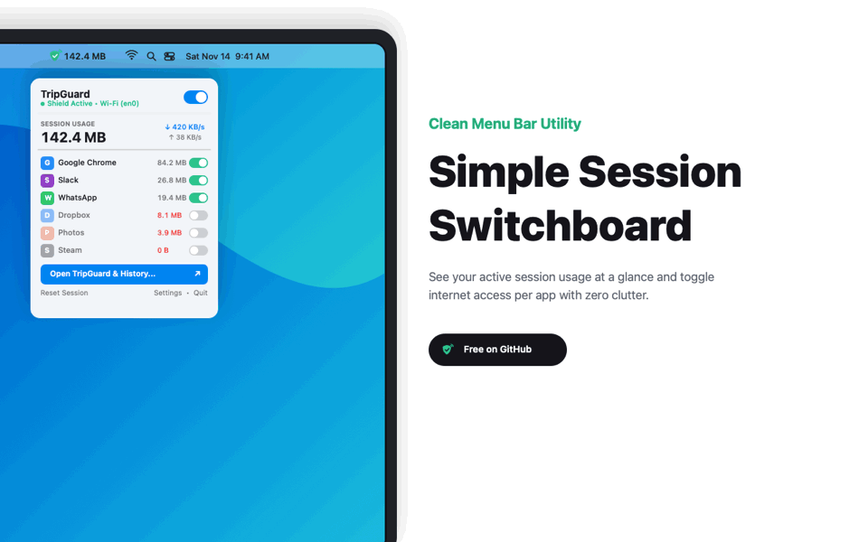

# TripGuard: Per-App Network Firewall & Bandwidth Controller for macOS

<p align="center">
  <a href="https://local-over.github.io/tripguard">
    
  </a>
</p>

<p align="center">
  <a href="https://github.com/local-over/tripguard/releases/latest"></a>
  
  
  
  <a href="LICENSE"></a>
</p>

TripGuard is a 100% free and open-source per-app network blocker, data cap protector, and live bandwidth monitor for macOS. Built as a clean, zero-subscription native alternative to TripMode, it lets you control which apps are allowed to access the internet, stop runaway background cloud syncers when tethered to a mobile hotspot, and enforce session data caps directly from your menu bar.

Created by **Hassan Elkady** ([@local-over](https://github.com/local-over)).

Website and Interactive Showcase: **[local-over.github.io/tripguard](https://local-over.github.io/tripguard)**

---

## Features

- **Ultra-Clean Menu Bar Popover:** See your active **Session Usage**, live download (`↓`) and upload (`↑`) speeds, and toggle internet access per app with zero clutter.
- **Full Native Desktop App & Historical Database:** Click **"Open TripGuard & History..."** to launch the full native macOS app window with persistent SQLite/JSON time-series tracking across **Current Session**, **Today (24h)**, **Last 7 Days**, **Last 30 Days**, and **12 Months**.
- **Smart Filters, Search & Sorting:** Filter applications by `All Apps`, `Allowed`, `Blocked`, or `Active Now`, search by name or bundle ID, and sort by `Total Data`, `Downloaded`, `Uploaded`, `Live Speed`, or `Name`.
- **Per-App Historical Breakdown & Socket Inspector:** Click any application row to inspect its dedicated historical bar chart, download vs. upload split, and live `lsof` TCP/UDP remote endpoints.
- **Automatic Helper Grouping:** Resolves child networking helpers (`Google Chrome Helper`, `Slack Helper`) to their parent `.app` bundle automatically using Darwin `proc_pidpath`.
- **Session Data Caps & Scenario Profiles:** Set automatic bandwidth limits (`100 MB` to `10 GB` or custom MB) and switch between `Default`, `Hotspot`, `Work`, and `Travel` firewall rule sets.
- **One-Click CSV Export:** Export full historical bandwidth reports to CSV directly from the desktop app.
- **Zero Subscriptions, Zero Telemetry:** Built in pure Swift using native macOS frameworks. 100% offline, MIT licensed, and free forever.

---

## Installation

### Pre-built Compiled Release
1. Download **[TripGuard.dmg (Apple Disk Image)](https://github.com/local-over/tripguard/releases/latest/download/TripGuard.dmg)** (or [TripGuard-macos.zip](https://github.com/local-over/tripguard/releases/latest/download/TripGuard-macos.zip)).
2. Open `TripGuard.dmg` and drag `TripGuard.app` into the **Applications** shortcut.
3. If macOS displays *"Cannot verify developer"*, go to **System Settings → Privacy & Security** and click **"Open Anyway"** (or run `xattr -cr /Applications/TripGuard.app` in Terminal).
4. Launch TripGuard. It runs quietly in your top menu bar with zero Dock clutter. Click the shield icon or press `⌥T` to activate.

### Build from Source
Requirements: macOS 13.0 or later with Xcode Command Line Tools.

```bash
git clone https://github.com/local-over/tripguard.git
cd tripguard
make bundle
make run
```

---

## Developer Support & Donations

If TripGuard saves your mobile hotspot data and helps your daily workflow, consider supporting **Hassan Elkady**:

- **PayPal:** [paypal.me/HassanElkady2](https://paypal.me/HassanElkady2)
- **USDT (TON Network / TRC20):** `UQBEJwLa4EGPRmUKw4O1i9d_JjJGmjkJ2myqR5lborzgceT-`
- **GitHub:** [@local-over](https://github.com/local-over)

---

## License

TripGuard is licensed under the [MIT License](LICENSE).
